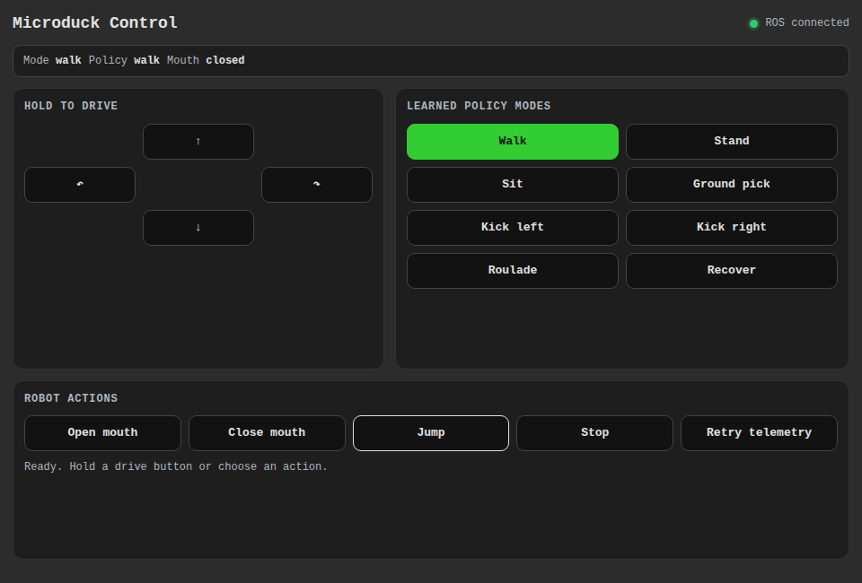
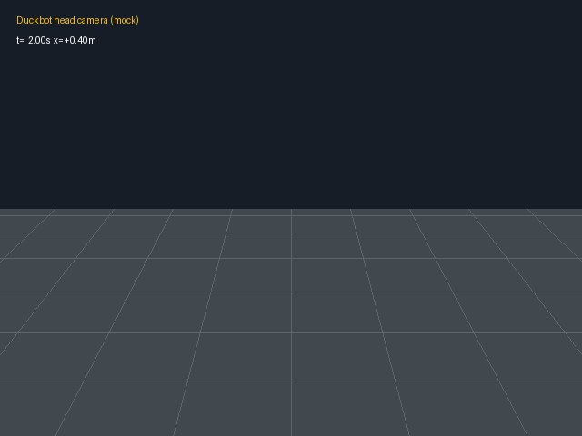

# Microduck simulation for Robo-Boy

Drive Pollen Robotics' Microduck in MuJoCo Warp and connect its ROS 2 Jazzy interfaces
to Robo-Boy. Use real CPU physics, an NVIDIA GPU, or a deterministic mock for integration
work. The existing trained policies provide walking, standing, sitting, kicks, and recovery.

The integration code is MIT licensed. **The bundled third-party robot CAD models have
non-commercial terms.** Those terms also apply to copies in the training tree and are
not replaced by MIT. Read [THIRD_PARTY.md](THIRD_PARTY.md) before using or redistributing
this demo, particularly for commercial work.

## Preview



The companion [Microduck Control panel](https://github.com/tessel-la/robo-boy-microduck-control-panel),
shown with sample telemetry.



Actual output from the policy-free mock backend. It is synthetic test imagery, not a
render of Microduck's CAD model or proof of physical motion. These previews contain no
third-party robot meshes; the real model's non-commercial terms remain unchanged.
See [preview provenance](docs/images/README.md).

## Run it

The Docker path targets Linux x86-64 with Docker Engine and Docker Compose **2.24.4 or
later** (the CPU/mock overlays use `!reset`). It uses host networking for DDS. CPU and
mock modes need no GPU; CUDA additionally needs an NVIDIA driver and Container Toolkit.
Docker Desktop and native macOS/Windows DDS deployments are not validated.

CPU physics uses native MuJoCo stepping with the same model, policy targets, and watchdogs. CUDA uses MuJoCo Warp. This avoids the pinned Warp CPU compiler failure while preserving the ROS/API contract.

Clone Robo-Boy alongside the simulator. Follow its README to prepare and start the app
and ROS stack; use the same ROS domain and CycloneDDS settings in both projects.
Stop other simulators in that domain. Never share a simulation test domain with a robot.

```bash
git clone https://github.com/tessel-la/robo-boy.git
git clone https://github.com/tessel-la/mujoco-warp-locomotion-sim.git
cd mujoco-warp-locomotion-sim
python3 tools/download_policies.py
docker compose --env-file ../robo-boy/.env -f docker-compose.yml -f docker-compose.cpu.yml up -d --build
docker compose ps
curl --fail http://127.0.0.1:8010/health
```

Python 3.10 or later is enough for the downloader; it needs no third-party packages or
account. It uses an immutable upstream revision and verifies every policy checksum.
Initial builds download large scientific Python wheels and compile runtime kernels;
allow several minutes and several GB of disk space. `ready: true` in `/health` confirms
the simulator backend initialized. The ROS bridge then joins the shared graph.

For a policy-free mock trial, skip the downloader and use this command instead:

```bash
docker compose --env-file ../robo-boy/.env -f docker-compose.yml -f docker-compose.mock.yml up -d --build
```

The mock image uses the smaller locked runtime without MuJoCo Warp. For NVIDIA, use the
base `docker-compose.yml` without the CPU/mock overlay. AMD hosts use CPU mode.

In Robo-Boy, connect to the shared ROS stack, add **Camera** with
`/locomotion/camera/image_raw` and a **3D view** with fixed frame `odom`.
Install [Microduck Control](https://github.com/tessel-la/robo-boy-microduck-control-panel)
through **Manage installations…**, add its tile, and request control before driving.
Its README also covers local source installation before public releases are available.

```bash
docker compose stop
```

Stopping preserves containers, logs, and the generated interface volume. Use the same
Compose overlay when restarting the CPU or mock simulator.

## How it fits

The simulator owns physics, policies, state, camera output, and command expiry. The ROS
sidecar publishes standard topics and exposes asynchronous motion actions. Robo-Boy
provides the UI and control gateway. The dashboard is optional.

The control panel uses standard ROS messages/services. The custom `microduck-interfaces`
overlay is needed only for behavior-tree actions; see [operation](docs/operation.md)
and the panel's opt-in Compose overlay. After changing custom interfaces, rebuild the
sidecar and restart Robo-Boy's ROS stack so rosbridge reloads the types.

## Develop

Use Python 3.12 and [uv](https://docs.astral.sh/uv/). `uv.lock` owns runtime and development
versions; Docker uses its generated, hash-checked requirements exports.

```bash
uv sync --locked --extra dev --extra mjwarp --python 3.12
python3 tools/download_policies.py
uv run --frozen --extra dev --extra mjwarp pytest
uv run --frozen --extra dev --extra mjwarp ruff check .
uv run --frozen mujoco-warp-locomotion-sim doctor --backend mock
```

For native real CPU physics, include `--extra mjwarp` when running `doctor --backend
mujoco_warp --device cpu`. Keep training dependencies in their separate image. See
[CONTRIBUTING.md](CONTRIBUTING.md), [AGENTS.md](AGENTS.md), and [guides](docs/README.md).

## Configuration

[config/default.toml](config/default.toml) owns simulator settings. Compose passes DDS
settings from Robo-Boy's environment and mounts the simulator's checked-in CycloneDDS
config by default. If you override its path, use a real host file shared by both stacks.

The command API and mesh server bind to **127.0.0.1** by default. Robo-Boy's same-host
mesh proxy supplies meshes to remote clients. For intentionally remote access, bind only
to a trusted VPN address or use an authenticated HTTPS proxy; the simulator API itself
has no authentication and bypasses Robo-Boy's control arbitration. `MJWARP_MESH_HOST`
controls mesh binding. ROS discovery remains separate from HTTP exposure.

## Limitations

- The CAD model's non-commercial restriction remains. Upstream does not identify the exact Creative Commons license version; do not assume commercial rights or a blanket MIT license for assets.
- The mock produces deterministic synthetic state and images, not real physics or learned motion. Download policies before using real CPU/CUDA physics.
- Host networking is intended for Linux. Only one simulator should own `/clock`, `/tf`, `/cmd_vel`, and mesh port 8000 in the selected environment.
- CPU physics can run slower than wall time. MuJoCo Warp has no AMD ROCm backend.
- Commands expire after 0.5 s; software stops complement physical safety and do not replace hardware emergency stops. This integration does not control physical Microduck hardware.
- Initial Docker builds remain dependent on public package/ROS repositories. Python package versions and policy bytes are locked; system package repositories and GPU drivers have their own update lifecycle.

## License

[MIT](LICENSE) for this integration. Policies, vendored training code, models, and their
derivatives retain the terms documented in [THIRD_PARTY.md](THIRD_PARTY.md).

The optional [camera WebRTC gateway](docs/camera-webrtc.md) publishes plain WHEP video for Robo-Boy and other standard clients.
